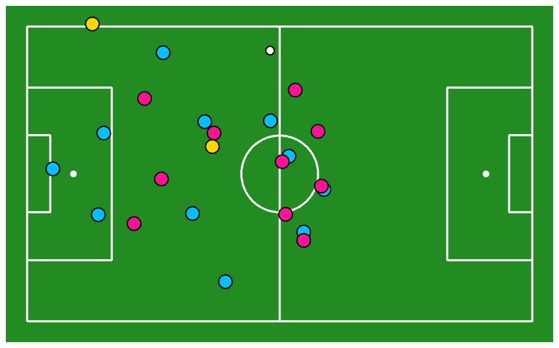
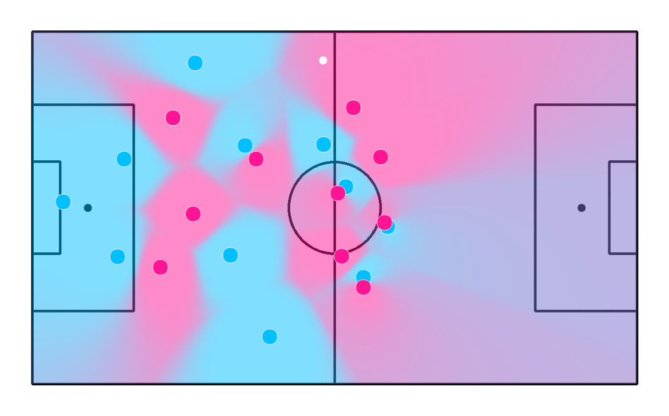
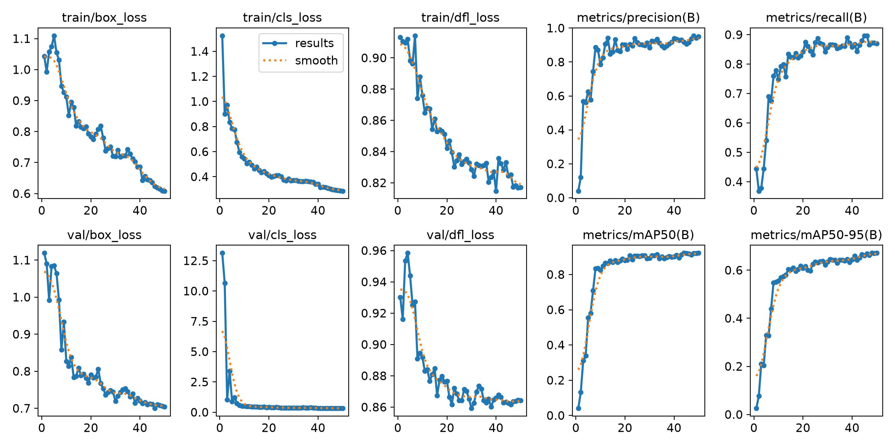
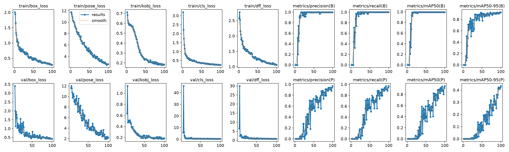
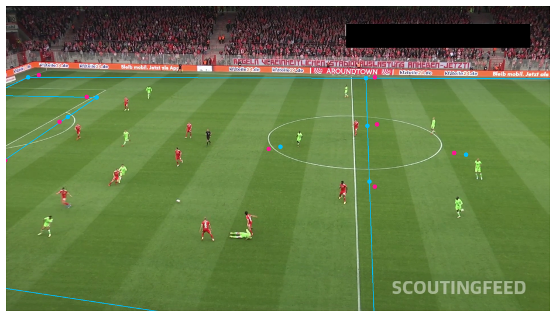

# Football AI

Phân tích video bóng đá bằng **YOLOv8, ByteTrack và SigLIP**, kết hợp nhận diện đối tượng, phân đội và ánh xạ vị trí lên mặt phẳng sân. Dự án được triển khai dưới dạng **Google Colab notebooks**, sử dụng GPU trên **Modal** cho huấn luyện và suy luận.

## Demo

[![Football AI demo]

https://github.com/user-attachments/assets/48522951-3345-4715-ab79-b7679f65d5e8

[Xem video](notebooks/assets/football-demo.mp4) · **Full HD**

## Tổng quan

Video truyền hình ghi lại diễn biến trận đấu dưới góc nhìn phối cảnh: camera thay đổi vị trí, kích thước đối tượng biến thiên và cầu thủ thường xuyên che khuất nhau. Để quan sát đội hình và chuyển động trên một sơ đồ thống nhất, cần kết hợp ba nhóm tác vụ: **phát hiện đối tượng**, **theo dõi và phân đội**, **ước lượng phép biến đổi từ ảnh camera sang sân bóng**.

Football AI sử dụng YOLOv8x để nhận diện bốn lớp đối tượng: **ball, goalkeeper, player, referee**. ByteTrack liên kết các detection giữa những frame liên tiếp; SigLIP cung cấp đặc trưng ảnh để phân nhóm cầu thủ theo đội mà không cần gán nhãn đội cho từng crop. Một mô hình YOLOv8x-pose riêng dự đoán 32 keypoint sân, tạo các cặp điểm tham chiếu để tính homography và biểu diễn vị trí trên radar 2D.

Các notebook được phát triển từ hướng tiếp cận của [Roboflow Sports](https://github.com/roboflow/sports) và [Roboflow Notebooks](https://github.com/roboflow/notebooks). Phần triển khai trong dự án gồm fine-tuning hai mô hình YOLOv8, chuyển tác vụ GPU từ runtime Colab sang Modal, lưu dataset/checkpoint bằng Volumes và bổ sung kiểm tra dữ liệu cho bước chiếu sân, phân đội và lọc đường đi bóng.

### Input và output

**Input:** video bóng đá từ góc quay truyền hình, các model detection/keypoint có quyền truy cập trên Roboflow và checkpoint SigLIP. Hai notebook huấn luyện sử dụng ảnh cùng bounding box hoặc nhãn keypoint từ dataset Roboflow.

**Output:** ảnh phân tích với bounding box hoặc ellipse, tracking ID và màu đội; keypoint/đường sân được chiếu lên ảnh camera; radar vị trí cầu thủ, trọng tài và bóng; biểu đồ Voronoi theo khoảng cách; đường đi bóng sau lọc. Clip demo ở trên minh họa tracking và radar. Các notebook huấn luyện trả về checkpoint, biểu đồ học và chỉ số validation.

### Luồng xử lý

1. **Detection:** đọc frame video và nhận diện bóng, cầu thủ, thủ môn, trọng tài. Lọc detection trùng bằng NMS trước các bước xử lý tiếp theo.
2. **Tracking:** đưa detection của các đối tượng người qua ByteTrack để duy trì ID giữa các frame. ID biểu thị một track, không phải số áo hay danh tính cầu thủ.
3. **Phân đội:** lấy mẫu crop cầu thủ mỗi 30 frame; SigLIP trích embedding 768 chiều, UMAP giảm xuống 3 chiều và KMeans chia thành hai nhóm. Mô hình phân nhóm đã fit được tái sử dụng để gán đội; thủ môn được gán theo khoảng cách tới centroid cầu thủ hai đội.
4. **Chiếu sân:** dự đoán 32 keypoint, giữ các điểm có confidence trên 0,5 và ghép với cấu hình sân chuẩn. Homography cần ít nhất bốn cặp điểm phù hợp, không thẳng hàng; bước chiếu đường bóng sử dụng RANSAC để giảm ảnh hưởng của điểm ngoại lai.
5. **Trực quan hóa:** biến đổi tọa độ neo của đối tượng sang sơ đồ sân, dựng radar/Voronoi và lọc các bước nhảy bất thường của bóng. Khi mất detection hoặc có nhiều ứng viên bóng, đường đi được ngắt thay vì nối qua khoảng trống.

  
  

*Radar biểu diễn vị trí sau phép chiếu; Voronoi mô tả vùng gần cầu thủ theo khoảng cách, chưa phải xác suất kiểm soát bóng.*

## Môi trường thực nghiệm

**Google Colab** là môi trường viết và chạy notebook: cấu hình secrets, gọi hàm từ xa, xử lý kết quả và hiển thị ảnh. **Modal Functions** cấp GPU cho training, detection và SigLIP; **Modal Volumes** giữ dataset, checkpoint và video giữa các phiên làm việc. GPU khai báo trong hàm Modal độc lập với GPU được chọn cho runtime Colab.

**Ultralytics** được dùng để fine-tune và đánh giá YOLOv8; **Roboflow Inference** tải model theo Model ID; **Supervision, OpenCV và Roboflow Sports** phục vụ xử lý detection, phép chiếu và trực quan hóa. Phần phân đội sử dụng **Transformers, UMAP và scikit-learn**.

### Notebooks

1. [Huấn luyện detector](notebooks/01_train_player_detector.ipynb): YOLOv8x trên **L40S**, 50 epochs, batch 6, kích thước ảnh 1280.
2. [Huấn luyện keypoint sân](notebooks/02_train_pitch_keypoint_detector.ipynb): YOLOv8x-pose trên **A100-80GB**, 100 epochs, batch 16, kích thước ảnh 640, mosaic 0.
3. [Phân tích video](notebooks/03_football_ai_demo.ipynb): detection, SigLIP và xử lý đường bóng trên **L40S**; UMAP/KMeans và phần hiển thị được điều khiển từ Colab.

Xem [hướng dẫn thiết lập Colab, Modal và API keys](notebooks/README.md). Có thể bắt đầu từ notebook phân tích nếu đã có quyền truy cập model. Ba file notebook giữ nguyên nội dung gốc, chỉ đổi tên.

## Dataset

| Dataset | Phiên bản | Train | Validation | Test | Nhãn |
|---|---:|---:|---:|---:|---|
| [Football Players Detection](https://universe.roboflow.com/roboflow-jvuqo/football-players-detection-3zvbc/dataset/12) | 12 | 298 | 49 | 25 | 4 lớp đối tượng |
| [Football Field Detection](https://universe.roboflow.com/roboflow-jvuqo/football-field-detection-f07vi/dataset/15) | 15 | 255 | 34 | 28 | 32 keypoint sân |

Video mẫu `121364_0.mp4` được notebook lấy từ nguồn giới thiệu trong hướng dẫn Roboflow cho [DFL Bundesliga Data Shootout](https://www.kaggle.com/competitions/dfl-bundesliga-data-shootout). Dataset ảnh dùng để huấn luyện hai mô hình; video dùng để minh họa pipeline phân tích.

Hai dataset Roboflow sử dụng giấy phép **CC BY 4.0**. Video tuân theo điều kiện sử dụng của nguồn DFL/Kaggle. Repository không bao gồm dataset tải về hoặc model weights.

## Đánh giá mô hình

Kết quả dưới đây lấy từ **lượt validation riêng** đã lưu trong hai notebook ngày 30/10/2026: detector được đánh giá trên **49 ảnh với 1.174 đối tượng**; mô hình sân được đánh giá trên **34 ảnh**. Các số liệu thuộc checkpoint tự fine-tune, chưa phải đánh giá trên test set hoặc phép đo toàn pipeline video.

### Precision, Recall và mAP

| Mô hình / tác vụ | Precision | Recall | mAP@50 | mAP@50:95 |
|---|---:|---:|---:|---:|
| YOLOv8x (bounding box đối tượng) | 94,39% | 86,85% | **92,09%** | 68,53% |
| YOLOv8x-pose (keypoint sân) | 94,00% | 94,10% | **89,79%** | 41,97% |

- **Precision = TP / (TP + FP)** và **Recall = TP / (TP + FN)**. TP, FP và FN được xác định qua phép ghép dự đoán với ground truth theo tiêu chí của từng tác vụ; metric pose đánh giá bộ keypoint của đối tượng, không phải tỷ lệ từng điểm được tìm thấy riêng lẻ.
- **AP** tổng hợp đường Precision–Recall; **mAP** lấy trung bình AP trên các lớp. Với detection, mAP@50 sử dụng ngưỡng IoU 0,50; mAP@50:95 lấy trung bình qua các ngưỡng 0,50–0,95, bước 0,05. Với pose, độ tương đồng keypoint được đánh giá bằng OKS thay cho IoU của bounding box.
- Bảng sử dụng metric **keypoint** cho mô hình sân. Bounding box bao sân là một đầu ra khác, không dùng để đánh giá độ chính xác của các điểm sân.

**Cách đọc mAP@50:95:** chỉ số này kiểm tra định vị ở nhiều ngưỡng khắt khe hơn mAP@50 nên thường thấp hơn. Mức **68,53%** của detector chưa thể xếp là tốt hay kém khi chưa có baseline cùng dataset. Mức **41,97%** của mô hình sân cho thấy chất lượng định vị keypoint còn hạn chế ở các ngưỡng khắt khe, dù mAP@50 đạt 89,79%. Giữ cả hai cột giúp phân biệt khả năng phát hiện với độ chính xác định vị; không diễn giải mAP@50 thành tỷ lệ dự đoán đúng của toàn pipeline.

README tổng hợp các chỉ số ở cấp mô hình; kết quả chi tiết theo lớp được giữ trong output notebook huấn luyện detector.

### Diễn biến huấn luyện và kết quả trực quan

*YOLOv8x: 50 epochs trên L40S, batch 6, ảnh 1280. Log ghi thời gian training 0,240 giờ, khoảng 14,4 phút.*

*YOLOv8x-pose: 100 epochs trên A100-80GB, batch 16, ảnh 640. Log ghi thời gian training 0,216 giờ, khoảng 13,0 phút. Thời gian này không bao gồm toàn bộ quá trình dựng môi trường và tải dữ liệu.*

Các biểu đồ thể hiện metric trong run huấn luyện. README sử dụng số của lượt validation riêng để tổng hợp kết quả; số ở cuối training có thể khác do cấu hình đánh giá và cần được đối chiếu theo cùng checkpoint, dataset và tham số.

**Kiểm tra overfit:** chưa thấy dấu hiệu rõ trong các run đã lưu. Loss training và validation nhìn chung cùng giảm; validation loss không tăng kéo dài trong khi training loss tiếp tục giảm. Ở detector, mAP@50:95 validation tăng từ **64,4% tại epoch 40** lên **67,1% tại epoch 50**. Ở mô hình sân, pose mAP@50:95 tăng từ **23,2% tại epoch 80** lên **43,3% tại epoch 100**, dù có dao động giữa các epoch. Đây là nhận xét từ log và biểu đồ huấn luyện; với 49 và 34 ảnh validation, vẫn cần test độc lập trên trận khác trước khi kết luận về khả năng tổng quát.

*Ví dụ chiếu sân trong notebook phân tích: các keypoint tham chiếu được ghép với cấu hình sân chuẩn để tạo đường sân trong ảnh camera.*

Ở lượt phân tích đã lưu, **493 crop cầu thủ** được chia thành hai nhóm **248/245**. Bước chiếu bóng xử lý **750 frame**, có **493 frame chứa một vị trí bóng hợp lệ trước lọc** và giữ **352 vị trí sau lọc khoảng cách**. Đây là số lượng đầu ra của các bước xử lý, không phải accuracy phân đội hoặc tracking. Notebook phân tích đang dùng player model công khai `football-players-detection-3zvbc/11`, khác checkpoint detector tự fine-tune được đánh giá trong các bảng trên.

## Tài liệu tham khảo

- [ByteTrack, Zhang et al., ECCV 2022](https://arxiv.org/abs/2110.06864): liên kết detection thành các track qua chuỗi frame.
- [SigLIP: Sigmoid Loss for Language Image Pre-Training, Zhai et al., ICCV 2023](https://arxiv.org/abs/2303.15343): mô hình nền tảng cho image embedding sử dụng ở bước phân đội.
- [UMAP, McInnes et al., 2018](https://arxiv.org/abs/1802.03426): giảm chiều đặc trưng trước KMeans.
- [Ultralytics YOLOv8 (tài liệu chính thức)](https://docs.ultralytics.com/models/yolov8/): kiến trúc và API huấn luyện, suy luận, validation cho detection và pose.
